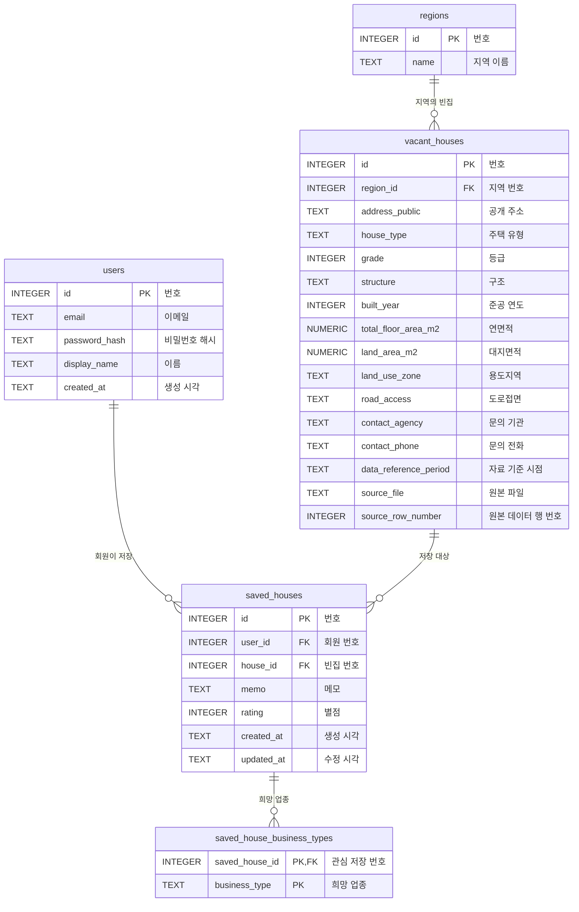

# 핵심 5개 테이블 ERD

PK는 행 번호를 식별하는 기본키, FK는 다른 테이블 번호를 참조하는 외래키입니다.
한 회원은 여러 빈집을 저장할 수 있고, 같은 빈집도 여러 회원이 저장할 수 있습니다.
관심 항목에 카페와 공방을 선택하면 희망 업종 테이블에는 두 행이 생깁니다.
중복 금지: regions.name, users.email, saved_houses(user_id,house_id), vacant_houses(source_file,source_row_number).