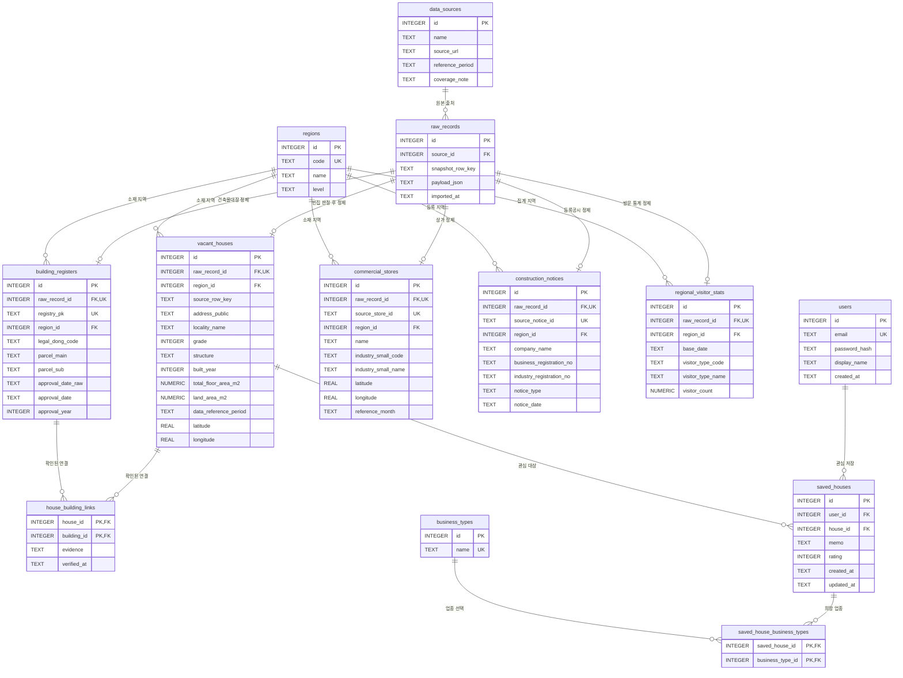

# 빈집 프로젝트 ERD

실제 생성된 SQLite 스키마를 기준으로 작성했습니다. PK는 기본키, FK는 외래키, UK는 중복 금지 키입니다.

빈집·건축물대장·상권·공시의 상세 컬럼 전체는 `테이블정의서.csv` 및 `schema.sql`에서 확인할 수 있습니다.

추가 복합 UNIQUE: raw_records(source_id, snapshot_row_key), saved_houses(user_id, house_id), regional_visitor_stats(region_id, base_date, visitor_type_code).

raw_records에서 정제 테이블로 가는 1:0..1 관계는 해당 자료의 정제 경로를 표현합니다. 현재 스키마는 정제 테이블별 raw_record_id 중복을 막지만 서로 다른 정제 테이블 사이의 배타성은 적재 프로그램에서 관리합니다.
